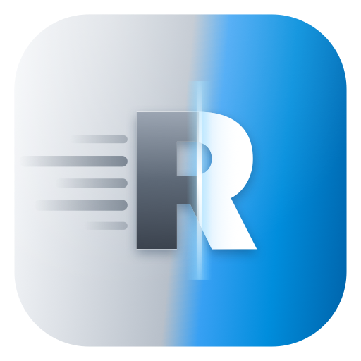

<p align="center">
  
</p>

<h1 align="center">Ronic MacToWindows</h1>

<p align="center">
  <b>Use Windows keyboard shortcuts on macOS, with the same muscle memory.</b><br>
  Ctrl+C/V, Home/End, Ctrl+←/→, Alt+Tab, Alt+F4, Win+L, Print Screen… · native Swift · imperceptible latency · menu bar only
</p>

<p align="center">
  <a href="https://github.com/jhowmael/Ronic-MacToWindows/releases/latest/download/RonicMacToWindows-macOS.zip">
    
  </a>
</p>

<p align="center">
  <a href="https://github.com/jhowmael/Ronic-MacToWindows/releases">All releases</a> ·
  <a href="#installation">Installation</a> ·
  <a href="#shortcuts">Shortcuts</a> ·
  <a href="#building-from-source">Build</a>
</p>

---

## Download

| System | File | Requirements |
|---|---|---|
| **macOS** (Apple Silicon and Intel) | [`RonicMacToWindows-macOS.zip`](https://github.com/jhowmael/Ronic-MacToWindows/releases/latest/download/RonicMacToWindows-macOS.zip) | macOS 14 Sonoma or later |

* **Menu bar only.** It doesn't show up in the Dock or in ⌘Tab.
* **Doesn't start at login.** It only runs when you open it. After turning on or restarting your Mac, open it again whenever you want.
* **Lightweight.** About 0.1 µs per keystroke and no CPU at all when idle: no timers, no polling.

> The app's menus are currently in Portuguese. Below, each menu item is given in English followed by its label in the app, in italics.

## Installation

1. Download and unzip `RonicMacToWindows-macOS.zip`. Drag **RonicMacToWindows.app** into **Applications**.
2. Open the app. The first time, macOS may block it: go to **System Settings › Privacy & Security** and click **Open Anyway**. From the Terminal instead: `xattr -dr com.apple.quarantine /Applications/RonicMacToWindows.app`.
3. Grant **Accessibility**: in **System Settings › Privacy & Security › Accessibility**, turn on **RonicMacToWindows**. The app opens that pane for you. Remapping starts as soon as you grant it, with no need to reopen the app.
4. Done. The **R** icon appears on the right side of the menu bar.

> **Enabled Accessibility but the app still says "not authorized"?** This happens after updating the app. macOS ties the permission to the binary's signature, so the toggle in Settings stays on but belongs to the previous version. Turning it off and on doesn't help.
> * The app detects this at launch: it removes the old entry and asks for the permission again. Just turn the toggle on once more.
> * If it still doesn't work, open the app's menu and click **Reset permission** (*Já ativei e não funciona: redefinir permissão*). If the permission shows as granted but shortcuts don't come back, use **Relaunch the app** (*Reabrir o app*).
> * From the Terminal: `tccutil reset Accessibility io.github.jhowmael.ronicmactowindows`, then open the app.

## Shortcuts

In these tables, **Alt = Option (⌥)** and **Win = Command (⌘)**. That's how macOS reads a PC keyboard.

### Editing (Ctrl → ⌘)

| Windows | Becomes on Mac | Action |
|---|---|---|
| Ctrl+C / Ctrl+X / Ctrl+V | ⌘C / ⌘X / ⌘V | Copy / cut / paste |
| Ctrl+Shift+V | ⌥⇧⌘V | Paste without formatting (where the app supports it) |
| Ctrl+Z / **Ctrl+Y** | ⌘Z / **⇧⌘Z** | Undo / redo |
| Ctrl+A / Ctrl+S / Ctrl+F | ⌘A / ⌘S / ⌘F | Select all / save / find |
| Ctrl+N / Ctrl+T / Ctrl+W | ⌘N / ⌘T / ⌘W | New window / new tab / close tab |
| Ctrl+P / Ctrl+L | ⌘P / ⌘L | Print / address bar |
| Ctrl+O / R / B / I / U / K | ⌘O / R / B / I / U / K | Open, reload, bold, italic, underline, link |
| Ctrl+= / Ctrl+- / Ctrl+0 | ⌘= / ⌘- / ⌘0 | Zoom |
| Ctrl+Shift+T, Ctrl+Shift+N… | ⇧⌘T, ⇧⌘N… | Shift is preserved |

### Text navigation

| Windows | Action |
|---|---|
| Home / End | Start / end of line (with **Shift**, selects) |
| Ctrl+Home / Ctrl+End | Start / end of the document |
| Ctrl+← / Ctrl+→ | Jump by word (with **Shift**, selects) |
| Ctrl+Backspace / Ctrl+Delete | Delete the word to the left / right |

> Home/End use ⌃A/⌃E (start/end of paragraph in Cocoa) instead of ⌘←/⌘→. That way, pressing Home on a web page doesn't trigger the browser's **Back**.

### Windows & system

| Windows | Action |
|---|---|
| **Alt+Tab** | Windows-style app switcher. Hold Alt and press Tab (Shift+Tab or ←/→ to go back). Release Alt to switch, or press Esc to cancel. A quick tap switches straight to the previous app. |
| Alt+F4 | Quits the active app (⌘Q, so the app still asks whether to save) |
| **Win+L** | Locks the screen |
| **Win+D** | Shows the desktop (press again to restore) |
| Ctrl+Shift+Esc | Opens Activity Monitor (the Mac's "Task Manager") |

**Not affected:** typing accents and special characters (´ ~ ^ ` ç, Option+letter) and your native ⌘ shortcuts, so ⌘C keeps working. The exceptions are ⌘L and ⌘D, which act as Win+L and Win+D. To use them the Mac way, turn off the **Win key** group in the menu.

### Screenshots straight to the clipboard

Like on Windows, screenshots go **straight to the clipboard**. Just paste with Ctrl+V wherever you want.

| Key | Capture |
|---|---|
| **Print Screen** | Area snip, like the Windows 11 Snipping Tool. Press Space to capture a window |
| **Shift+Print Screen** | Full screen |
| **Win+Shift+S** | Area snip, like on Windows |
| **⇧⌘4** / **⇧⌘3** (Mac shortcuts) | Also go to the clipboard instead of becoming a file on the Desktop |

* Turn it on or off in **menu › Shortcuts › Screenshots → clipboard** (*Atalhos › Prints → área de transferência*). When it's off, Print Screen opens the capture toolbar (⇧⌘5) and the Mac shortcuts save files again.
* Works in every app, including ignored ones. macOS itself takes the capture (⌃⇧⌘3/4), so the app **does not need** Screen Recording permission.
* ⇧⌘5 (the capture toolbar) is left alone. There, you choose the destination under **Options**.
* Win+Shift+S uses the physical ⇧⌘S key. Windows-style "Save As" (**Ctrl+Shift+S**) keeps working.

## Menu bar

| Item (label in the app) | What it does |
|---|---|
| **Pause / Enable remapping** (*Pausar / Ativar remapeamento*) | Fully turns keyboard capture off (zero cost) and back on. The icon is dimmed while paused. |
| **Accessibility** (*Acessibilidade*) | Shows whether the permission was granted, opens Settings, and offers **Reset permission** for when the toggle is on but not applied (after an update). |
| **Shortcuts** (*Atalhos*) | Turns each group on or off: Editing, Text navigation, Windows, Win key, Screenshots → clipboard. |
| **Ignored apps** (*Apps ignorados*) | **Ignore "current app"** with one click, **Add app…** to pick an .app, click an entry to remove it, **Restore defaults**. |
| **Quit** (*Sair*) | Quits the app (⌘Q while the menu is open). |

### Ignored apps

In ignored apps, **the original Control key is preserved**, because terminals need Ctrl+C to interrupt processes. In those apps, Editing and Text navigation are off. Alt+Tab, Alt+F4, Win+L, screenshots, etc. keep working.

Ignored by default: Terminal, iTerm2, Warp, Ghostty, kitty, Alacritty, WezTerm, Windows App (Remote Desktop), Parallels, VMware Fusion and UTM.

## Tips

* **Mac keyboard in the PC layout.** On a Mac keyboard, the keys next to the space bar are Control, Option, Command. On a PC they are Ctrl, Win, Alt. If you want **Alt right next to the space bar**, like on Windows, swap Option and Command in **System Settings › Keyboard › Keyboard Shortcuts › Modifier Keys**.
* **Alt+F4 on Mac keyboards.** The Mac's F1–F12 keys are media keys by default. Use **fn+Alt+F4**, or turn on "Use F1, F2, etc. keys as standard function keys" in **Settings › Keyboard**.
* **Print Screen** on PC keyboards reaches the Mac as **F13**, and that's the key the app listens to.
* **Ctrl+←/→** normally switches Spaces on macOS. The app intercepts it first, so it jumps by word instead. In ignored apps, the Mac behavior comes back.

---

## How it works

```
 keyboard ──▶ CGEventTap (HID level, own thread) ──▶ macOS / global shortcuts ──▶ active app
                 │  reads 1 snapshot (~20 ns lock): enabled? ignored app? groups?
                 │  rewrites keyCode + flags of the SAME event and returns it (no new events)
                 └─ Alt+Tab, Win+L, Win+D, screenshots: only enqueues the action on the main thread
```

* **Native Swift + Quartz.** No Electron, no WebView. The binary is about 1.5 MB.
* **The callback only compares integers:** keyCode and flags. No I/O, no logging, no allocation, no UI work. Measured at about 0.1 µs per keystroke.
* **Dedicated thread** (QoS *userInteractive*) with its own CFRunLoop. If the UI is busy, typing is never delayed.
* **HID-level tap:** the rewrite happens before macOS's global shortcuts. That's why Ctrl+← becomes ⌥← instead of switching Spaces.
* **keyUp follows keyDown:** if you release Ctrl before the letter, the key never gets "stuck" in the app.
* **Automatic re-enable:** if macOS disables the tap on a timeout, it is turned back on immediately.
* **Frontmost app cache:** the bundle ID is kept up to date by NSWorkspace notifications. No polling.
* **On-demand Alt+Tab:** the app list and icons are built only when you press Alt+Tab and thrown away when you release it.

## Repository layout

```
.
├── Package.swift                         Swift Package (macOS 14+)
├── Resources/
│   ├── Info.plist                        LSUIElement = true (no Dock icon), bundle id, version
│   └── AppIcon.icns                      generated by branding/make-icons.sh
├── Sources/RonicMacToWindows/
│   ├── main.swift                        entry point (.accessory)
│   ├── App/
│   │   ├── AppDelegate.swift             single instance; no Login Items
│   │   ├── AppController.swift           wires everything; permission; tap state
│   │   └── StatusMenuController.swift    menu bar icon + menu
│   ├── Core/
│   │   ├── RemapEngine.swift             CGEventTap + remapping rules (hot path)
│   │   ├── KeyCodes.swift                key codes and modifier masks
│   │   ├── SharedState.swift             thread-safe snapshot read by the tap
│   │   └── Settings.swift                preferences (groups, ignored apps)
│   ├── Services/
│   │   ├── FrontmostAppTracker.swift     frontmost app + most-recently-used order
│   │   ├── AccessibilityPermission.swift permission status, prompt and reset
│   │   └── SystemActions.swift           lock screen, show desktop, screenshots, Activity Monitor
│   └── Switcher/
│       ├── AppSwitcher.swift             Alt+Tab logic
│       └── SwitcherPanel.swift           floating icon panel
├── branding/                             code-generated logo + icon script
├── scripts/
│   ├── package-macos.sh                  builds the .app and the .zip
│   └── dev-signing.sh                    stable local certificate (permission survives rebuilds)
└── .github/workflows/release.yml         publishes the download when a tag is pushed
```

## Building from source

Requirement: **Xcode or Command Line Tools** (Swift 5.9+), on macOS 14+.

```bash
git clone https://github.com/jhowmael/Ronic-MacToWindows.git
cd Ronic-MacToWindows

make app       # → dist/RonicMacToWindows.app + dist/RonicMacToWindows-macOS.zip
make install   # builds and copies it to /Applications
make icons     # regenerates the logo and AppIcon.icns
```

### Testing

1. Run `make install`, then open **RonicMacToWindows** from Applications (or run `open /Applications/RonicMacToWindows.app`).
2. Grant Accessibility. The menu bar icon stops showing the ⚠️.
3. In **TextEdit** or **Notes**, type some text and try Ctrl+A, Ctrl+C, Ctrl+V, Ctrl+Z, Ctrl+Y, Home/End, Shift+Home, Ctrl+←/→ and Ctrl+Backspace.
4. Type accented characters (á, ã, ç, ê) and check that nothing changed.
5. Try Alt+Tab with 3 or more apps open, Win+D twice, and Ctrl+Shift+Esc.
6. Press **Win+Shift+S** (or Print Screen), select an area and paste it with Ctrl+V in TextEdit.
7. In **Terminal**, run `sleep 100` and press **Ctrl+C**. The process should stop, because Terminal is ignored by default.
8. From the menu, try **Pause**, turning a group off, **Ignore "current app"**, and **Quit**.

> **Rebuilt the app?** On your machine, `make app` always signs with the same local certificate (`scripts/dev-signing.sh`, stored in `~/.ronic-mirror-signing` and shared with Ronic Mirror). That way the Accessibility permission **keeps working after rebuilding**. On CI, signing is ad-hoc, and the app handles the version change on its own, as described in [Installation](#installation).

## Publishing a new version

```bash
git tag v1.3.0
git push origin v1.3.0
```

The [release.yml](.github/workflows/release.yml) workflow builds the universal app (Apple Silicon + Intel) and creates the Release with `RonicMacToWindows-macOS.zip`. The download button in this README always points to the latest version.

**To distribute without security warnings (optional):** sign with a *Developer ID* and notarize: `SIGN_IDENTITY="Developer ID Application: …" ./scripts/package-macos.sh`, then `xcrun notarytool submit …`.

## Known limitations

* **Password fields:** while a secure text field has focus, macOS blocks keyboard interception. In those fields, the Mac shortcuts (⌘C, ⌘V) still work.
* **Home/End in soft-wrapped text** go to the start and end of the *paragraph*, not the visual line.
* **Alt+Tab** switches between apps, like ⌘Tab, not between individual windows.
* **Non-QWERTY layouts** (Dvorak, Colemak): shortcuts follow the physical QWERTY/ABNT2 key positions.
* **Win+L and Win+D** use internal macOS APIs. If Apple removes them, the app falls back to ⌃⌘Q to lock and to hiding apps to show the desktop.
* **Not on the Mac App Store**, because the store's sandbox doesn't allow a CGEventTap that modifies events.

## License

Choose a license for the project before distributing it (for example, MIT).
